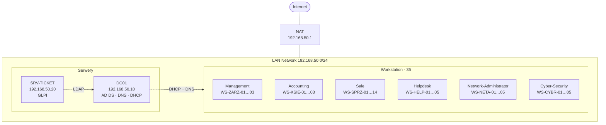

# 🏢  NismoNET IT Support Lab - Corporate Environment Simulation

# 📌 About the Project

The project is a fully functional, virtual IT environment for a small business (NismoNET), created to demonstrate and develop skills in Windows Server administration, PowerShell automation, and technical support (Helpdesk).

The environment simulates the work of 35 employees divided into 6 operational departments. The project includes centralized identity management, group policies, a file server with appropriate restrictions, a ticketing system, and a set of SOPs.

# 🏗️ Architecture and Networking

## 📅 Implementation Roadmap
Below is a chronological record of the environment's setup. Each step links to a separate document containing screenshots, the scripts used, and a description of the configuration.

* **[Phase 1: Domain Controller Installation and Configuration](./docs/phase1-ad.md)**
  * Installation and configuration of Windows Server 2022 (DC01).
  * Deployment of AD DS, DNS, and DHCP roles.
  * Creation of a logical OU (Organizational Units) structure that reflects the company’s departments.
  * Assigning permissions to individual departments
    
* **[Phase 2: Network Addressing and DHCP](./docs/phase2-ad.md)**
  * Deployment of the DHCP role on DC01.
  * Creation of the 192.168.50.100–200 scope, with the lower range reserved for devices that need a fixed address.
  * Configuration of options 003, 006 and 015 — gateway, domain DNS server and domain suffix.
  * Authorization of the DHCP server in Active Directory and verification of a client lease.

* **[Phase 3: Directory Structure and Delegation](./docs/phase3-ad.md)**
   * Creation of an OU tree mirroring the company's departments, with separate
     containers for workstations and service accounts.
   * Security groups with a consistent `GG_` prefix, one per department and one
     per role.
   * Delegation of password reset and account enable/disable to the helpdesk
     group, scoped to the user OU rather than the domain.
   * Verification from a non-administrative account, including a negative test
     confirming the delegation is narrow.
     
* **[Phase 4: User Account Provisioning](./docs/phase4-ad.md)**
  * Bulk creation of 35 accounts from a CSV file using a PowerShell script.
  * Input validation before any account is created: required fields, login format and length,
    duplicates, and existence of the target OU and group.
  * Automatic placement in the department OU and membership in the matching group.
  * A log of every run and a separate CSV report listing rejected rows with the reason.
 
* **[Phase 5: Workstation and Group Policy](./docs/phase5-ad.md)**
  * Installation of a Windows 11 workstation and its join to the domain, with the computer object placed in the workstation OU.
  * Password policy enforced at domain level through the Default Domain Policy.
  * Drive mapping through Group Policy Preferences with item-level targeting by group membership, so one policy serves every department.
  * Verification from a user account on the station, confirming that a Sales user receives their own drives and not another department’s.
 
* **[Phase 6: File Server and Access Control](./docs/phase6-ad.md)**
  * Three volumes labelled by purpose, holding the departmental and shared data areas.
  * Shares created with the real permissions set at NTFS level and inheritance broken on each department folder.
  * A permission matrix mapping every group to its level of access.
  * Negative verification: an account from one department is denied access to another department’s data.
