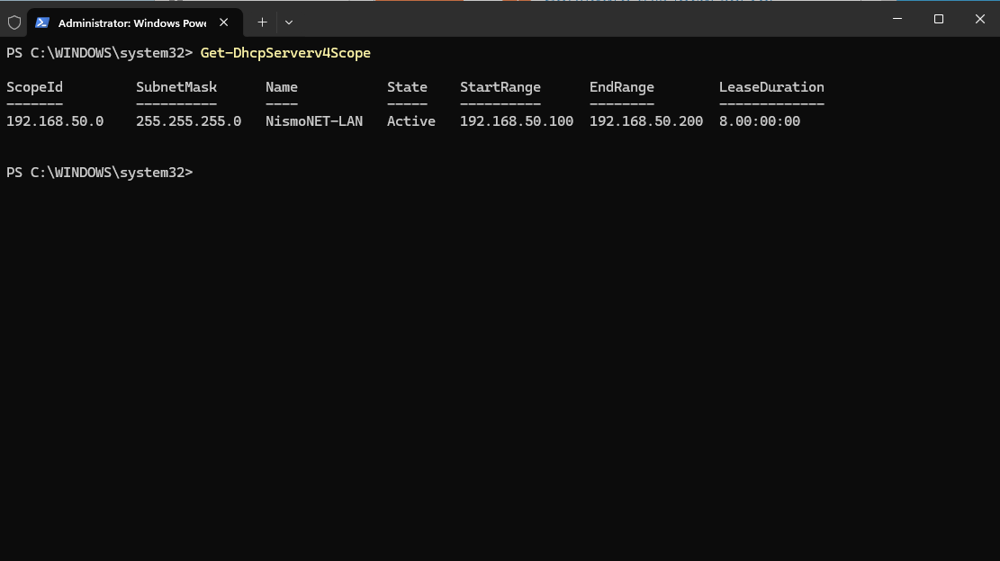
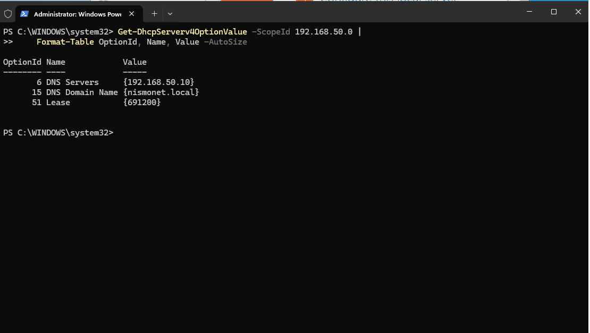
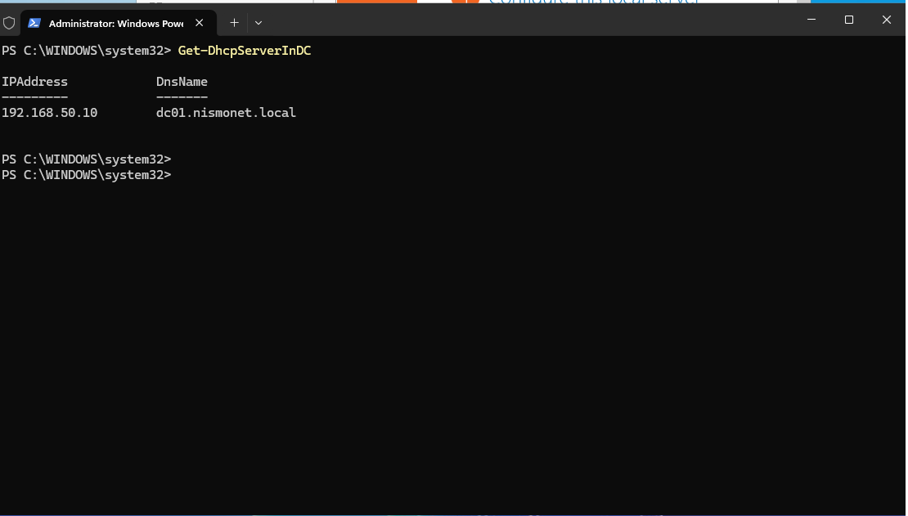
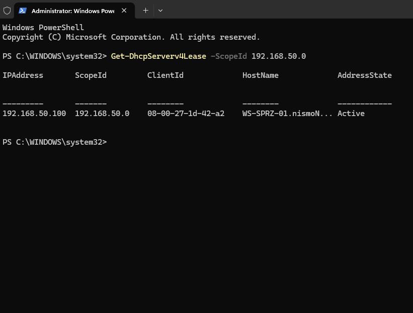

## Phase 2: Network Addressing and DHCP

**Goal.** Give workstations addressing that is enough to work in the domain —
not just an IP address, but the gateway, the domain DNS server and the domain
suffix. A station with an address but no DNS server will not log in.

**Starting point.** DC01 was already a domain controller with a static address
and a working DNS server. Clients had nothing — every adapter had to be
configured by hand. The DHCP role showed as "Available" in Server Manager,
which means it was not installed.

**Steps**
- Installed the DHCP role together with its management tools. Without them the
  PowerShell cmdlets do not appear, which is why the first attempt to create a
  scope returned "the term is not recognized".
- Created the scope .100 to .200, deliberately leaving the lower part of the
  range for devices that need a fixed address — the server, printers,
  switches. The point is that DHCP never hands out an address someone has
  already set manually.
- Set three scope options: gateway, DNS server and domain suffix. The DNS
  option has to hold the controller's address rather than a public resolver,
  or the station will not find the SRV records it needs to authenticate.
- Registered the server in Active Directory. A DHCP server in a domain serves
  no leases until it is authorized — the mechanism exists so nobody can plug
  in their own server and start handing out wrong addresses.

```powershell
Install-WindowsFeature DHCP -IncludeManagementTools

Add-DhcpServerv4Scope -Name "NismoNET-LAN" `
    -StartRange 192.168.50.100 `
    -EndRange 192.168.50.200 `
    -SubnetMask 255.255.255.0 `
    -State Active

Set-DhcpServerv4OptionValue -ScopeId 192.168.50.0 `
    -Router 192.168.50.1 `
    -DnsServer 192.168.50.10 `
    -DnsDomain "nismonet.local"

Add-DhcpServerInDC -DnsName "DC01.nismonet.local" -IPAddress 192.168.50.10
```

**Verification**



The scope is active and covers the configured range.



Options 003, 006 and 015 are set, so a client receives the gateway, the domain
DNS server and the suffix along with its address.



DC01 is listed as an authorized DHCP server — the state whose absence caused
the failure described below.



WS-SPRZ-01 holds a lease from the pool and is registered under its fully
qualified domain name, which shows the whole chain works end to end.

**What went wrong.** The server stopped serving addresses without reporting
any error. The scope was active and correctly configured, yet stations fell
back to APIPA addresses. The DHCP server log was what finally showed it: event
code 56, authorization failure. Re-registering the server in Active Directory
changed the entry to code 55 and leases resumed immediately. Along the way it
also turned out that options 006 and 015 were missing, which would have
blocked domain logon even once addressing worked.

**Takeaway.** Five things were genuinely misconfigured along the way, but none
of them was the cause. Since then I look at the server log first and test the
client second.
