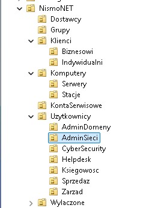
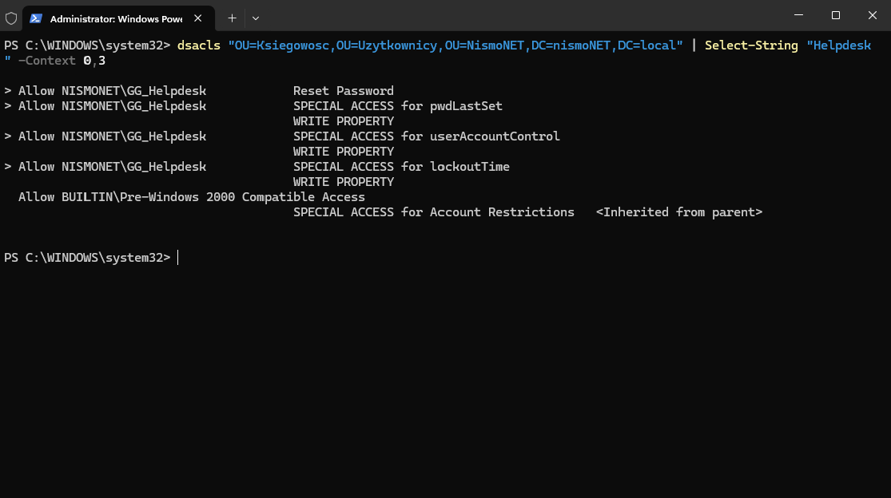
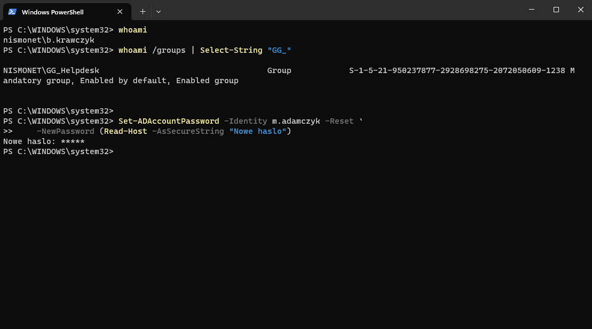
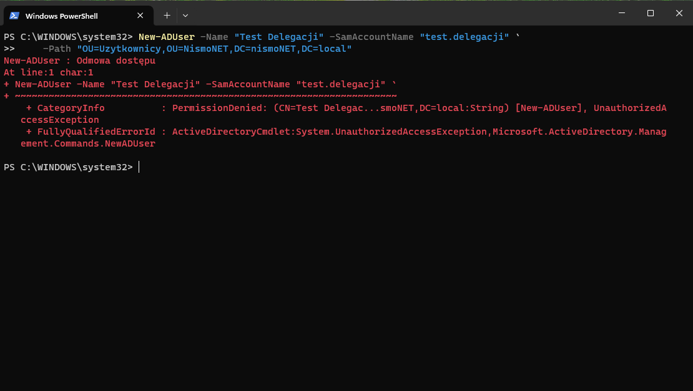

## Phase 3: Directory Structure and Delegation

**Goal.** Organise the directory so that accounts are not all sitting in one
place, and so that the helpdesk can reset passwords without domain
administrator rights.

**Starting point.** A fresh domain has only the default containers, Users and
Computers. A container cannot carry a group policy link or a delegation, so
every change in the directory had to go through a domain administrator
account.

**Steps**
- Built an OU tree mirroring the departments, with separate containers for
  workstations and service accounts. An OU is the only level where a policy
  can be linked and where rights can be handed to someone else, so the split
  is functional rather than cosmetic.
- Created security groups with a consistent GG_ prefix, one per department and
  one per role, so the purpose of a group is readable from its name.
- Kept the three business departments as plain domain users with no
  administrative rights. Their access lives in NTFS permissions on the file
  server, not in the directory.
- Delegated password reset and account enable/disable to GG_Helpdesk on the
  user OU — not on the domain — using the Delegation of Control wizard.
- Verified it from a separate account in that group, running an ordinary
  console with no elevation. Directory rights come from group membership, not
  from local elevation; the two are easy to confuse.

| Group | What it may do |
|---|---|
| GG_AdminDomeny | full control of the directory |
| GG_AdminSieci | server access, user management, password changes |
| GG_CyberSecurity | reading and reviewing logs |
| GG_Helpdesk | password reset, enabling and disabling accounts |
| GG_Ksiegowosc / GG_Sprzedaz / GG_Zarzad | domain user only, access to their own resources |

```powershell
Get-ADOrganizationalUnit -Filter * -SearchBase "OU=NismoNET,DC=nismoNET,DC=local" |
    Select-Object Name, DistinguishedName |
    Sort-Object DistinguishedName

Get-ADGroup -Filter "Name -like 'GG_*'" |
    Select-Object Name, GroupCategory, GroupScope |
    Sort-Object Name
```

**Verification**



Departments are separate OUs, with workstations and service accounts in
containers of their own — the level where policies are linked and rights
delegated.



dsacls shows what actually sits on the object: GG_Helpdesk holds Reset
Password and write access to userAccountControl. I used dsacls rather than
Get-Acl because it resolves the GUIDs into readable names.



whoami confirms the account is in GG_Helpdesk and is not a domain
administrator. The reset succeeds from an ordinary, non-elevated console.



The same account cannot create a user. This is the stronger of the two tests:
a successful operation proves something is open, a denial proves everything
else is closed.

**What went wrong.** A password reset from the helpdesk account failed even
though the group was supposed to be able to do it. Checking the access control
list on the OU showed why — there was no entry for the helpdesk group at all,
so the delegation had never reached the object:

```powershell
dsacls "OU=Ksiegowosc,OU=Uzytkownicy,OU=NismoNET,DC=nismoNET,DC=local" |
    Select-String "Helpdesk"
```

In Active Directory the rights live on the object being accessed — the OU —
not on the group receiving them, so the group's own properties would never
have shown this. I applied the entries from a script instead: the Reset
Password extended right plus write access to pwdLastSet, userAccountControl
and lockoutTime, identified by GUID rather than by display name so that it
works regardless of the server's language.

The OUs holding administrative accounts were deliberately left out of the
scope. Applied one level higher, the same delegation would have let the
helpdesk reset a network administrator's password and take over the domain.

Group membership is written into the access token at logon, so the test
account had to log off and back on before the new rights took effect.

**Takeaway.** The structure decides where a policy can be linked and what can
be delegated. And a delegation is tested from an account that has only that
delegation, never from one that has everything.
