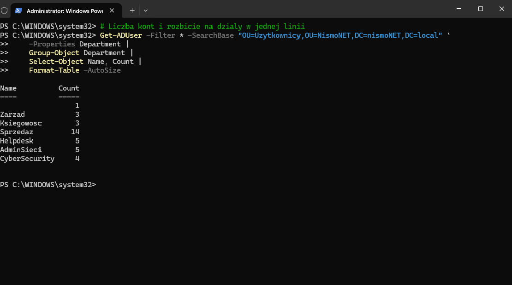

## Phase 4: User Account Provisioning

**Goal.** Create 35 accounts in a way that can be repeated, and that rejects
bad input instead of writing it into the directory. Doing it by hand would
take hours and guarantee a typo somewhere.

**Starting point.** The OU structure and the groups existed; there were no
accounts yet. The input was a CSV file with first name, surname, login,
department and job title — the kind of file that arrives from HR in a real
company, and is almost never filled in perfectly.

**Steps**
- Wrote a script that reads the CSV and creates the accounts. Most of its
  length is not account creation but validation, which is the point of it.
- For every row it checks that the required fields are present, that the login
  fits the length limit and the allowed format, that the account does not
  already exist, and that the target OU and group are actually there. A row
  that fails any of these is skipped with a reason, and the rest of the file
  continues.
- Each account is placed in its department OU and added to the matching group.
- OU and group lookups are cached in hashtables, so with 35 rows across six
  departments the script queries the directory six times instead of seventy.
- Every run produces a log of what happened and a separate CSV report listing
  the rejected rows and why. The log is for reconstructing the run; the report
  is for fixing the input file and running it again.

Script: [`New-ImportUsers.ps1`](../scripts/New-ImportUsers.ps1)

**Verification**
Script run: [`log-import-run.txt`](logs/log-import-run.txt)

The run reports each account as it is created and ends with a summary of
successes, warnings and errors.

Grouping the accounts by their department attribute confirms that every one
landed in the right place and that the counts match the input file.

A row with missing data is not created and not silently skipped — it appears
in the report with the reason, so the input file can be corrected.

**What went wrong.** The first version carried on after an error. A row with
bad data printed a message and the script cheerfully created the next account,
so I only found out at the end. Setting `$ErrorActionPreference = "Stop"` with
try/catch turned that into a controlled stop naming the row at fault.

The second problem was subtler. Inside a `catch` block I referred to the
current row as `$_` — but in a catch, `$_` is the error object, not the loop
item. Every property came back empty, the target path was built as
`OU=,OU=Uzytkownicy,...`, and the directory rejected it with "the object name
has bad syntax". The fix was to assign the loop item to a variable of its own
at the start of each iteration.

**Takeaway.** Writing a script that creates accounts takes half an hour. 
The rest of the time goes into making sure it does not create rubbish — and that is the half that matters.
