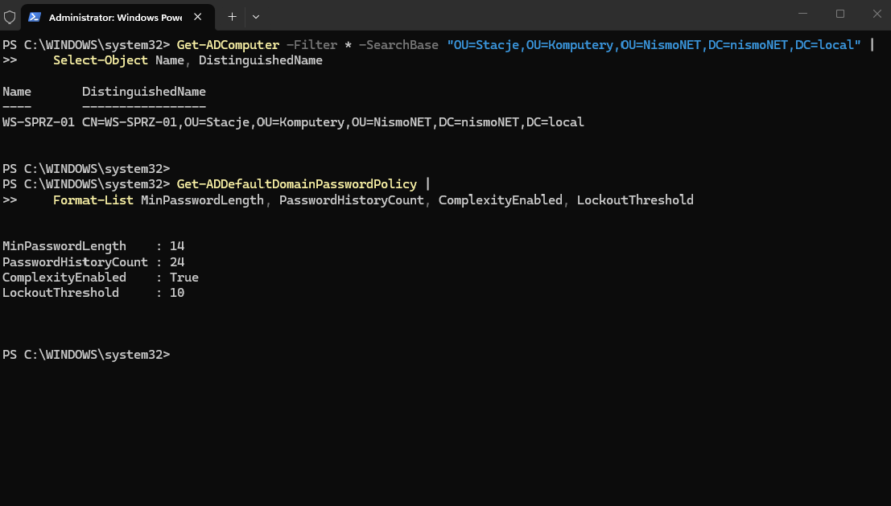
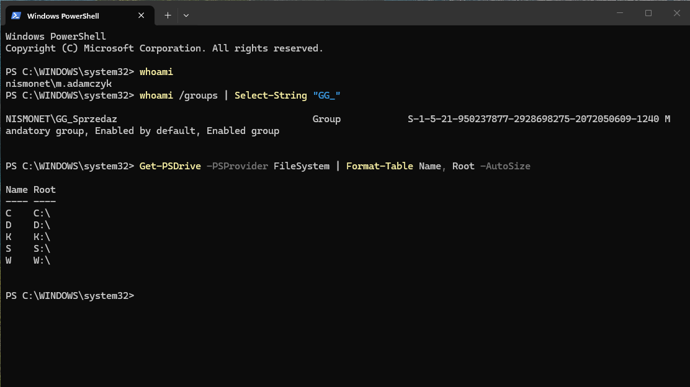

## Phase 5: Workstation and Group Policy

**Goal.** Add a real workstation to the environment — a machine that
authenticates against the domain and receives its settings centrally. Only
from this point can the domain be called working: everything before it had
been verified from the server side alone.

**Starting point.** The domain, DNS, DHCP, accounts and groups were ready.
There was no client at all, so nothing proved that a user could actually log
in and get what they were supposed to get.

**Steps**
- Installed Windows 11, joined the station to the domain and placed the
  computer object in the OU meant for workstations. A computer object is an
  identity of its own, with a password the machine changes automatically — the
  station authenticates much like a user does.
- Set the password policy in the Default Domain Policy. This is not a matter
  of convenience: a password policy for domain accounts only works at domain
  level. Linked to an OU it does nothing, because accounts do not take it from
  where they happen to sit. Differentiating requirements per group needs
  fine-grained password policies, which are a separate mechanism.
- Mapped drives through Group Policy Preferences with item-level targeting by
  group membership, so one policy serves every department instead of one
  policy per department.
- Verified on the station, from a user account rather than from the server.
  That is the only place where what actually applied is visible.

**Verification**

The station is a member of the domain and its object sits in the workstation
OU, which is where policies for machines are linked.

gpresult run as the logged-on user lists the policies that applied and the
groups the account belongs to — the two things that together decide what the
user ends up with.

A Sales account receives its own department drive and the shared one, and not
the Accounting drive.

**What went wrong.** The first drive mapping applied incorrectly — a Sales
user ended up with the Accounting drive. The targeting condition had been set
on one entry only; the others had none, and an entry with no condition applies
to everyone. It was a working mechanism with an incomplete configuration,
which is the hardest kind of fault: nothing reports an error, the result is
simply wrong.

**Takeaway.** A policy that applied is not the same as a policy that worked.
gpresult will report a policy as active even when it is doing something other
than what you intended. You check it at the user, by looking at the outcome.
