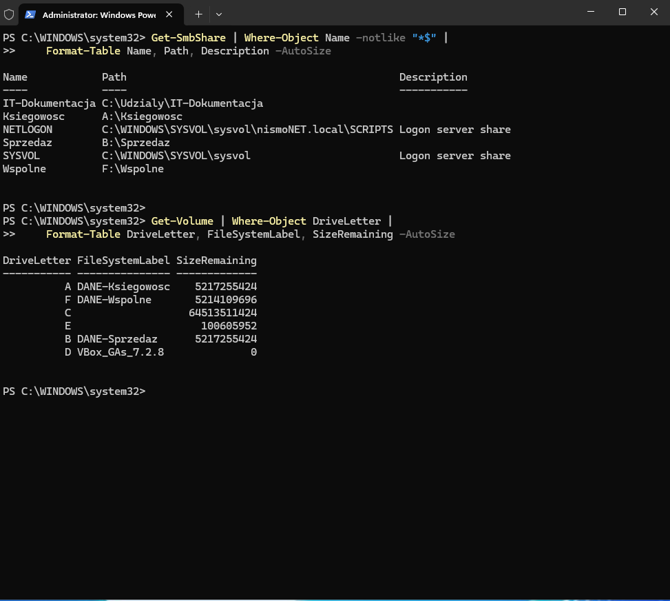
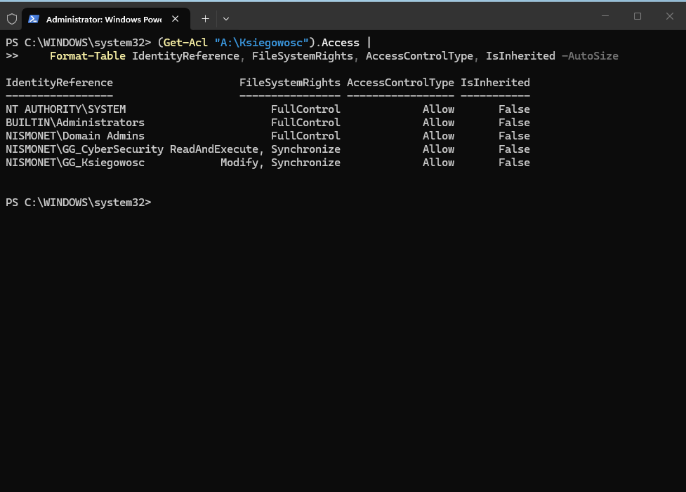
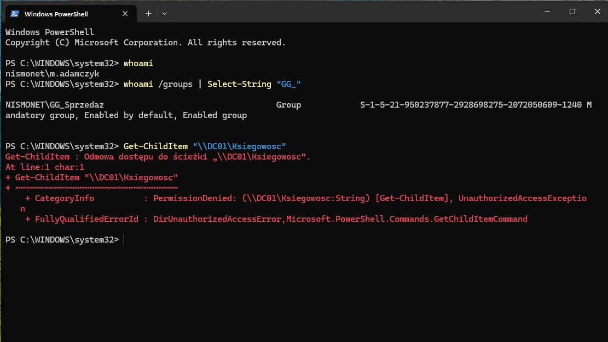

## Phase 6: File Server and Access Control

**Goal.** Give each department its own area for data, where access is decided
by group membership rather than by knowing the path. A mapped drive restricts
nothing on its own — the letter is convenience, not a boundary.

**Starting point.** Three separate volumes on the server, accounts and groups
in place, and drive mapping from the previous phase already working. The
policy was handing users drive letters, but there was nothing behind them yet
to decide who could open what.

**Steps**
- Labelled the volumes after their purpose and created the department folders
  on them. With three disks showing up as bare letters, the label is the only
  thing telling a technician what is what.
- Shared the folders over the network but set the real permissions at the NTFS
  level, leaving the share permissions broad. A share governs access over the
  network; NTFS governs access to the files whichever way they are reached,
  and the effective result is the more restrictive of the two. Keeping the
  precision in one place means there is only one place to look when it needs
  changing — and the restriction holds for someone sitting at the server too.
- Broke inheritance on the department folders, so permissions granted higher
  up do not flow down and show every department everything.
- Gave each department full access to its own folder, with the shared volume
  open to all domain users.
- Verified from an account in a different department by trying to open what it
  should not be able to open.

| Area | Group | Access |
|---|---|---|
| Accounting | GG_Ksiegowosc | full |
| Sales | GG_Sprzedaz | full |
| Shared | Domain Users | read and write |
| Accounting / Sales | any other department | none |

**Verification**

The shares exist and point at the folders on their own volumes.

Inheritance is disabled on the department folder and only the department group
is listed, so permissions from the volume above do not flow down.

A Sales account cannot open the Accounting share. This is the test that
matters: a working drive proves something is reachable, a denial proves
everything else is not.

**What went wrong.** The group policy was mapping drives to paths that did not
exist — the folders were there, but the shares had never been created.
`net view` against the server listed only NETLOGON and SYSVOL. From the
workstation it looked like a Group Policy problem, because no drive appeared;
the cause was one level below that.

Separately, the volume labels did not match their contents — the disk labelled
as the shared one held accounting data. Cosmetic, but in a real company enough
for someone to put files in the wrong place.

**Takeaway.** Mapping a drive is not access control. The letter tells a user
where to go; the access control list decides whether they get in. You do not
confirm that by reading the configuration — only by trying to open it from an
account that should not be able to.
